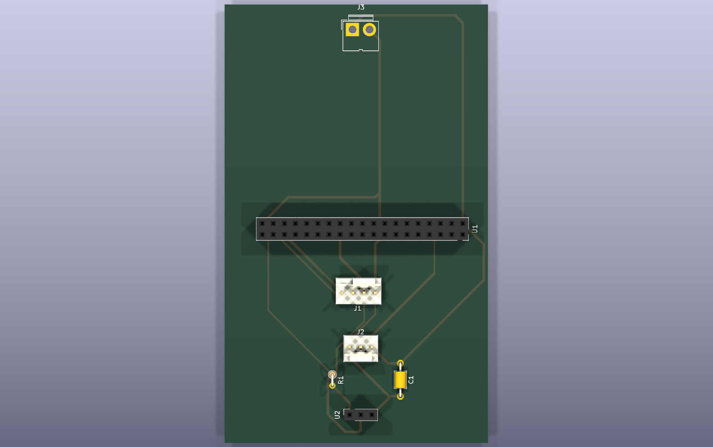
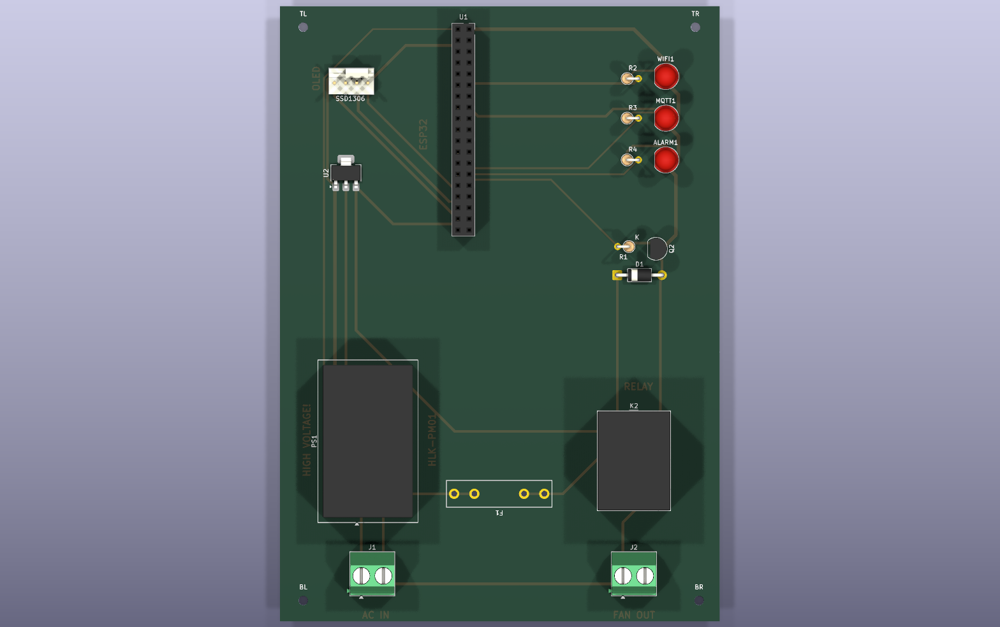

# Hardware

Two ESP32-WROOM-32 nodes: a **sensor node** that measures the house climate and an **actuator node** that switches equipment. Both talk to the backend over MQTT (topic `telemetry/send` for readings, `commands/{house_id}/{device}` for control).

```
hardware/
├── sensor_node_esp32/      Arduino firmware — sensor node
├── actuator_node_esp32/    Arduino firmware — actuator node
├── i2c_scanner/            utility sketch to find I²C addresses (OLED)
└── pcb/                    PCB design files, revision 2.0 (KiCad 9)
    ├── sensor_node/
    └── actuator_node/
```

Each board folder under `pcb/` contains:

| Path | What it is |
|---|---|
| `*.kicad_pro`, `*.kicad_sch`, `*.kicad_pcb` | KiCad 9 project, schematic and board layout (open the `.kicad_pro`) |
| `exports/*_schematic.pdf` | Schematic, readable without KiCad |
| `exports/*_pcb_layout.pdf` | Copper, silkscreen and outline layers |
| `exports/*_3d_top.png`, `*_3d_bottom.png` | 3D renders of the assembled board |
| `gerbers/` | Gerber and drill files (RS-274X / Excellon) |
| `*_gerbers_*.zip` | The same Gerbers zipped, ready to upload to a PCB fab |

## Sensor node — 100 × 60 mm

| Ref | Part | Role |
|---|---|---|
| U1 | ESP32-WROOM-32 (DevKit header) | Wi-Fi + MQTT |
| U2 | DHT22 | Temperature / humidity, GPIO 4, 10 kΩ pull-up (R1) |
| J2 | MQ-135 module | Air quality / ammonia, analog on GPIO 34 |
| J1 | SSD1306 OLED (I²C) | Local display |
| J3, C1 | Power input + bulk capacitor | |



## Actuator node — 140 × 100 mm

Mains-powered: it draws its own 5 V from the AC line and switches a fan.

| Ref | Part | Role |
|---|---|---|
| U1 | ESP32-WROOM-32 (DevKit header) | Wi-Fi + MQTT |
| PS1 | HLK-PM01 | 230 V AC → 5 V DC |
| U2 | AMS1117-3.3 | 3.3 V regulator |
| K2 | Omron G5LE-1 relay | Switches the fan (J2 *FAN OUTPUT*) |
| Q2, R1, D1 | NPN driver, 10 kΩ base resistor, 1N4007 flyback diode | Relay coil drive |
| F1 | Fuse | On the AC input (J1 *AC INPUT*) |
| WIFI1, MQTT1, ALARM1 + R2–R4 | Status LEDs, 220 Ω | Wi-Fi, broker and alarm state |
| — | SSD1306 OLED (I²C) | Local display |



> **Mains voltage.** The actuator board carries 230 V AC on J1, PS1, F1, K2 and J2. Keep the high-voltage area enclosed and never work on the board while it is plugged in.

## Firmware and PCB revisions

The firmware in `actuator_node_esp32/` was written on the breadboard prototype and drives four outputs (fan PWM on GPIO 18, heater, feeder and lighting relays on GPIO 19, 5 and 23). PCB revision 2.0 carries **one** relay channel (the fan) plus status LEDs and an OLED. Check the pin mapping in the sketch against `exports/actuator_node_schematic.pdf` before flashing the firmware onto the v2.0 board.

## Before flashing

Both sketches ship with placeholders. Set them first:

```cpp
const char* ssid        = "YOUR_WIFI_SSID";
const char* password    = "YOUR_WIFI_PASSWORD";
const char* mqtt_server = "192.168.1.100";   // LAN IP of the PC running Mosquitto
```

Libraries: `PubSubClient`, `ArduinoJson`, `DHT sensor library` (sensor node), `Adafruit SSD1306` + `Adafruit GFX` (OLED).

## Ordering the boards

Upload the `*_gerbers_*.zip` of a board to any PCB fab (2 layers, 1.6 mm FR-4). To regenerate the exports after editing the design:

```bash
kicad-cli sch export pdf -o exports/<board>_schematic.pdf <project>.kicad_sch
kicad-cli pcb render --side top -o exports/<board>_3d_top.png <project>.kicad_pcb
```
